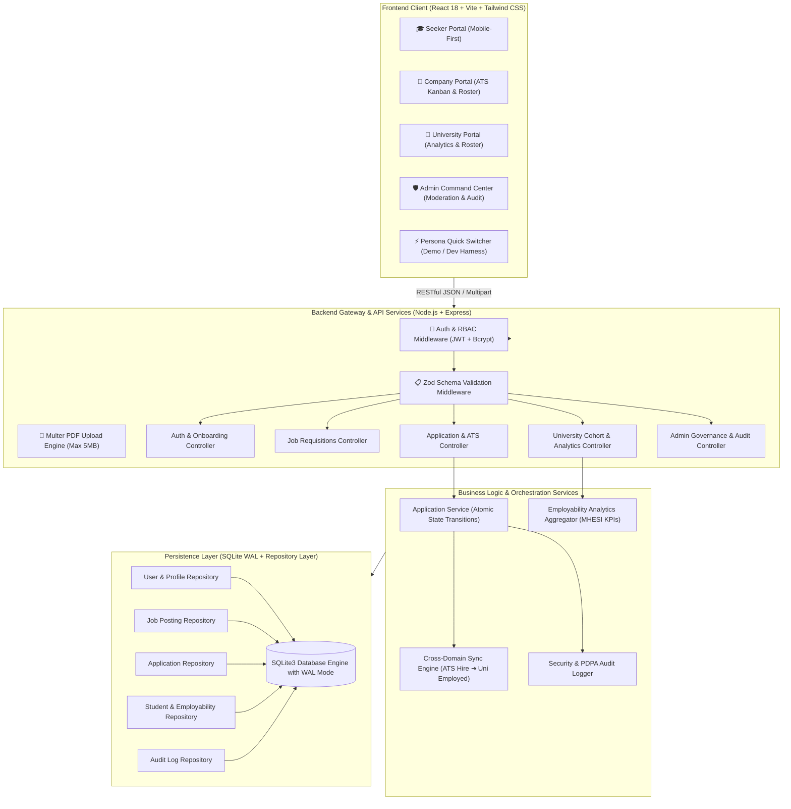
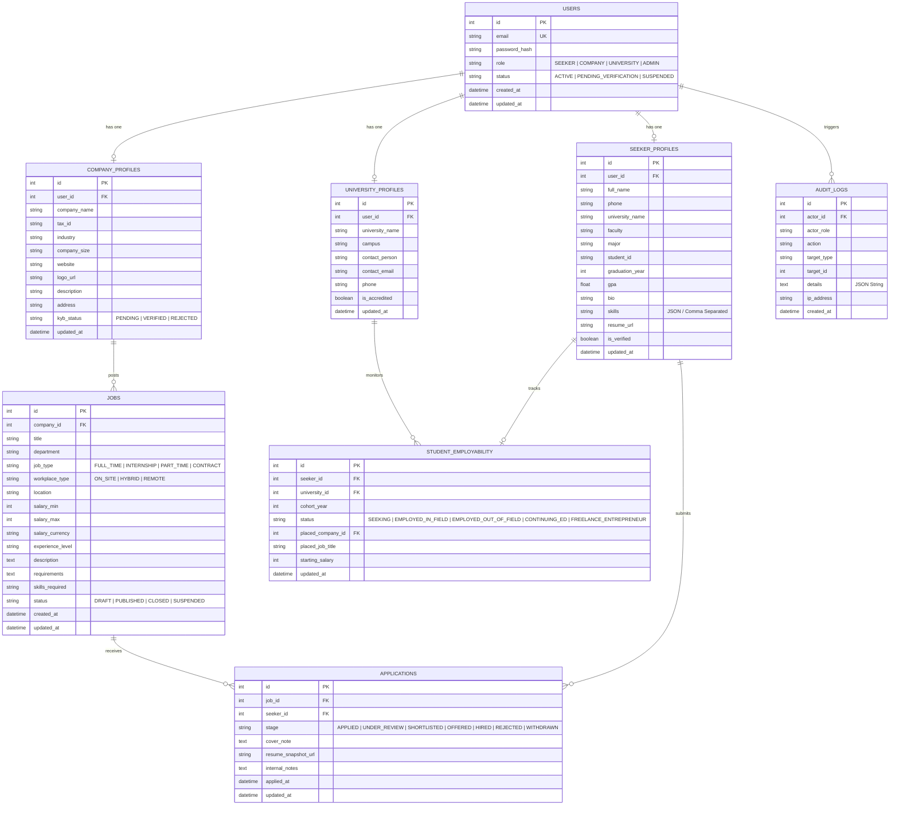

# Jobmatch Technical System Architecture & Blueprint
**Project:** Jobmatch (4-Sided Talent & Employability Ecosystem)  
**Chief System Architect:** Marcus Sterling  
**Target Audience:** Database Engineer, Backend Engineer, Frontend Engineer, QA, Security, and Leadership  
**Document Reference:** [`docs/ARCHITECTURE.md`](file:///C:/Users/b/OneDrive/Desktop/Agent%20Office/workspaces/jobmatch/docs/ARCHITECTURE.md)  
**Associated Specs:** [`docs/PRD.md`](file:///C:/Users/b/OneDrive/Desktop/Agent%20Office/workspaces/jobmatch/docs/PRD.md) | [`docs/DESIGN_SYSTEM.md`](file:///C:/Users/b/OneDrive/Desktop/Agent%20Office/workspaces/jobmatch/docs/DESIGN_SYSTEM.md) | [`wireframe_preview.html`](file:///C:/Users/b/OneDrive/Desktop/Agent%20Office/workspaces/jobmatch/wireframe_preview.html)  

---

## 1. Executive Summary & Architectural Vision

Jobmatch is an enterprise-grade multi-tenant talent platform serving four distinct stakeholder personas:
1. **Job Seekers / University Students (`SEEKER`)**: Mobile-first discovery, 1-click verified application, live progress stepper.
2. **Employers (`COMPANY`)**: Corporate brand presence, job requisition management, ATS Kanban pipeline, stage progression.
3. **Universities (`UNIVERSITY`)**: Real-time student cohort monitoring, graduate placement tracking, MHESI accreditation analytics.
4. **Platform Administrators (`ADMIN`)**: KYB corporate credential verification, job moderation, and PDPA-compliant audit governance.

This architecture enforces **high cohesion, low coupling, deterministic data integrity**, and guarantees that cross-cutting actions (e.g., when an employer marks a student as `HIRED`, the university's accreditation roster updates atomically to `EMPLOYED_IN_FIELD`) occur safely without race conditions or inconsistent states.



---

## 2. Tech Stack & Dependencies Rationale

| Layer | Selected Technology | Version / Package | Architecture Rationale & Justification |
| :--- | :--- | :--- | :--- |
| **Runtime** | **Node.js** | v24.x LTS (Verified active) | High I/O throughput, native modern ECMAScript modules, universal compatibility on Windows. |
| **Database** | **SQLite 3 (WAL Mode)** | Native `DatabaseSync` / SQLite3 | Zero external dependency setup, single-file ACID transactional compliance, microsecond in-memory query performance with persistent disk durability. Perfect for local prototyping, testing, and production containerization. |
| **Backend Framework** | **Express.js** | ^4.21.0 | Unopinionated, predictable middleware chaining, standard industry REST pattern, simple integration with custom RBAC and file uploads. |
| **Security & Auth** | **JWT + Bcrypt.js** | `jsonwebtoken` ^9.0.2<br>`bcryptjs` ^2.4.3 | Stateless JWT tokens, role claims embedded in payload, salted password hashing (rounds = 10), preventing credential leakages. |
| **File Storage** | **Multer** | ^1.4.5-lts.1 | Strict stream validation: whitelist `application/pdf`, max size `5 * 1024 * 1024` bytes (5MB), automated local directory indexing. |
| **Data Validation** | **Zod** | ^3.23.8 | Strict compile-time and runtime input schema validation across request bodies, query params, and route parameters. |
| **Frontend Framework** | **React 18** | ^18.3.1 | Declarative component hierarchy, high ecosystem maturity, optimal compatibility with Kanban drag-and-drop and real-time state steppers. |
| **Build Tool** | **Vite** | ^5.4.0 | Sub-100ms Hot Module Replacement (HMR), instant development server start, optimized Rollup bundle output. |
| **Styling & Design Tokens** | **Tailwind CSS** | ^3.4.10 | Direct implementation of Maya Lin's design system: Royal Blue (`#2563EB`), Emerald (`#10B981`), Deep Navy (`#1E3A8A`), Amethyst (`#7C3AED`), Amber (`#D97706`). |
| **Iconography** | **Lucide React** | ^0.446.0 | Modern, lightweight, accessible SVG icons identical to wireframe prototype (`graduation-cap`, `building-2`, `landmark`, `shield-check`, etc.). |
| **Routing** | **React Router DOM** | ^6.26.0 | Client-side routing with declarative Role Guards (`<ProtectedRoute allowedRoles={['COMPANY']} />`). |

---

## 3. Target Project Directory Structure

The project follows a modular, monorepo-style workspace separating `server/`, `client/`, `database/`, and `shared/` while enabling single-command parallel orchestration.

```
jobmatch/
├── docs/
│   ├── PRD.md                       # Product Requirements Document (Sophia Chen)
│   ├── DESIGN_SYSTEM.md             # UI/UX Specifications & Tokens (Maya Lin)
│   └── ARCHITECTURE.md              # Technical Architecture & Blueprint (Marcus Sterling)
├── database/                        # Database Layer (Owned by Database Engineer)
│   ├── schema.sql                   # Clean DDL defining all tables, keys, triggers
│   ├── seeds.sql                    # Initial seed dataset with 4 roles & verified entities
│   ├── db.ts                        # Database connection initialization (WAL mode enabled)
│   └── migrate.ts                   # Schema migration & seed execution script
├── shared/                          # Universal Types & Constants
│   └── types.ts                     # Shared TypeScript interfaces, DTOs & role enums
├── server/                          # Backend API Engine (Owned by Backend Engineer)
│   ├── package.json
│   ├── tsconfig.json
│   ├── uploads/
│   │   └── resumes/                 # Local directory for uploaded candidate PDF resumes
│   └── src/
│       ├── index.ts                 # Express entry point, middleware registration, HTTP listener
│       ├── config/
│       │   └── env.ts               # Environment variables (PORT, JWT_SECRET, UPLOAD_DIR)
│       ├── middleware/
│       │   ├── auth.ts              # JWT verification & req.user attachment
│       │   ├── rbac.ts              # Role-Based Access Control gatekeeper
│       │   ├── upload.ts            # Multer PDF filter and storage config
│       │   ├── validate.ts          # Zod schema validation middleware
│       │   └── errorHandler.ts      # Global centralized error handler
│       ├── routes/
│       │   ├── authRoutes.ts        # /api/auth/*
│       │   ├── jobRoutes.ts         # /api/jobs/*
│       │   ├── applicationRoutes.ts # /api/applications/*
│       │   ├── universityRoutes.ts  # /api/university/*
│       │   └── adminRoutes.ts       # /api/admin/*
│       ├── controllers/
│       │   ├── authController.ts
│       │   ├── jobController.ts
│       │   ├── applicationController.ts
│       │   ├── universityController.ts
│       │   └── adminController.ts
│       ├── services/
│       │   ├── authService.ts       # Registration & token issuance
│       │   ├── jobService.ts        # Requisition business logic
│       │   ├── applicationService.ts# 1-Click apply & ATS stage transitions
│       │   ├── syncService.ts       # Cross-domain ATS Hire -> University sync logic
│       │   ├── universityService.ts # Cohort KPIs & accreditation stats
│       │   └── auditService.ts      # PDPA compliance & system event logging
│       └── repositories/            # Data Access Object (DAO) Pattern
│           ├── userRepository.ts
│           ├── jobRepository.ts
│           ├── applicationRepository.ts
│           ├── studentRepository.ts
│           └── auditRepository.ts
├── client/                          # Frontend Application (Owned by Frontend Engineer)
│   ├── package.json
│   ├── vite.config.ts
│   ├── tailwind.config.js
│   ├── postcss.config.js
│   ├── tsconfig.json
│   ├── index.html
│   └── src/
│       ├── main.tsx                 # Root React mounting
│       ├── App.tsx                  # Global routing & layout shell
│       ├── index.css                # Tailwind directives & typography imports
│       ├── context/
│       │   ├── AuthContext.tsx      # Current active user, token, persona switcher state
│       │   └── ToastContext.tsx     # Toast notification dispatcher
│       ├── services/                # API client layer
│       │   ├── api.ts               # Axios / Fetch client with auth headers
│       │   ├── authApi.ts
│       │   ├── jobApi.ts
│       │   ├── applicationApi.ts
│       │   ├── universityApi.ts
│       │   └── adminApi.ts
│       ├── components/
│       │   ├── common/              # Shared atomic UI components
│       │   │   ├── Navbar.tsx       # Universal responsive navigation header
│       │   │   ├── PersonaSwitcher.tsx # Live role-switching demo controller
│       │   │   ├── Badge.tsx        # Status pills (Verified, Applied, Hired, etc.)
│       │   │   ├── Modal.tsx        # Accessible dialog wrapper
│       │   │   ├── Toast.tsx        # Success/Error interactive toasts
│       │   │   └── Skeleton.tsx     # CLS-free shimmering loading states
│       │   ├── seeker/              # Seeker components
│       │   │   ├── JobCard.tsx
│       │   │   ├── JobSearchFilters.tsx
│       │   │   ├── OneClickApplyModal.tsx
│       │   │   └── ApplicationStepper.tsx
│       │   ├── company/             # Company components
│       │   │   ├── ATSKanbanBoard.tsx
│       │   │   ├── ATSCandidateCard.tsx
│       │   │   ├── CandidateDetailDrawer.tsx
│       │   │   └── JobRequisitionModal.tsx
│       │   ├── university/          # University components
│       │   │   ├── KPICard.tsx
│       │   │   ├── PlacementBreakdownChart.tsx
│       │   │   ├── StudentRosterTable.tsx
│       │   │   └── MHESIReportModal.tsx
│       │   └── admin/               # Admin components
│       │       ├── KYBVerificationQueue.tsx
│       │       ├── FlaggedJobsTable.tsx
│       │       └── AuditLogsTable.tsx
│       └── pages/
│           ├── HomePage.tsx         # Unified Landing Page
│           ├── AuthPage.tsx         # Registration & Login
│           ├── seeker/
│           │   ├── SeekerJobsPage.tsx
│           │   ├── SeekerProfilePage.tsx
│           │   └── SeekerApplicationsPage.tsx
│           ├── company/
│           │   ├── CompanyJobsPage.tsx
│           │   └── CompanyATSPage.tsx
│           ├── university/
│           │   ├── UniversityDashboardPage.tsx
│           │   └── UniversityStudentsPage.tsx
│           └── admin/
│               └── AdminCommandPage.tsx
├── package.json                     # Monorepo root scripts (`npm run dev`, `npm run build`)
└── README.md
```

---

## 4. Component & API Contract Specifications

### 4.1 Relational Data Models & DDL Specification



---

### 4.2 Standardized Enumerations & Types

```typescript
// shared/types.ts

export type UserRole = 'SEEKER' | 'COMPANY' | 'UNIVERSITY' | 'ADMIN';
export type UserStatus = 'ACTIVE' | 'PENDING_VERIFICATION' | 'SUSPENDED';

export type JobType = 'FULL_TIME' | 'INTERNSHIP' | 'PART_TIME' | 'CONTRACT';
export type WorkplaceType = 'ON_SITE' | 'HYBRID' | 'REMOTE';
export type JobStatus = 'DRAFT' | 'PUBLISHED' | 'CLOSED' | 'SUSPENDED';

export type ApplicationStage = 
  | 'APPLIED' 
  | 'UNDER_REVIEW' 
  | 'SHORTLISTED' 
  | 'OFFERED' 
  | 'HIRED' 
  | 'REJECTED' 
  | 'WITHDRAWN';

export type EmployabilityStatus = 
  | 'SEEKING' 
  | 'EMPLOYED_IN_FIELD' 
  | 'EMPLOYED_OUT_OF_FIELD' 
  | 'CONTINUING_ED' 
  | 'FREELANCE_ENTREPRENEUR';

export type KYBStatus = 'PENDING' | 'VERIFIED' | 'REJECTED';
```

---

### 4.3 RESTful API Endpoints Contract

#### A. Authentication & User Context (`/api/auth`)
* `POST /api/auth/register`
  * **Payload**: `{ email, password, role: 'SEEKER'|'COMPANY'|'UNIVERSITY', profileData: {...} }`
  * **Response**: `201 Created` -> `{ token, user: { id, email, role, status }, profile: {...} }`
* `POST /api/auth/login`
  * **Payload**: `{ email, password }`
  * **Response**: `200 OK` -> `{ token, user: { id, email, role, status }, profile: {...} }`
* `GET /api/auth/me`
  * **Headers**: `Authorization: Bearer <token>`
  * **Response**: `200 OK` -> `{ user, profile }`

#### B. Job Requisitions (`/api/jobs`)
* `GET /api/jobs`
  * **Query**: `?keyword=dev&type=FULL_TIME&location=Bangkok&remote=true&page=1&limit=10`
  * **Access**: Public / Seeker
  * **Response**: `200 OK` -> `{ jobs: JobSummary[], total: number, page: number }`
* `GET /api/jobs/:id`
  * **Access**: Public / Seeker / Company
  * **Response**: `200 OK` -> `JobDetail`
* `POST /api/jobs`
  * **Access**: Protected (`COMPANY`)
  * **Payload**: `{ title, department, job_type, workplace_type, location, salary_min, salary_max, description, requirements, skills_required, status: 'DRAFT'|'PUBLISHED' }`
  * **Response**: `201 Created` -> `JobDetail`
* `PUT /api/jobs/:id`
  * **Access**: Protected (`COMPANY` owner)
  * **Response**: `200 OK` -> `JobDetail`
* `PATCH /api/jobs/:id/status`
  * **Access**: Protected (`COMPANY` owner or `ADMIN`)
  * **Payload**: `{ status: 'PUBLISHED' | 'CLOSED' | 'SUSPENDED' }`
  * **Response**: `200 OK`

#### C. Job Applications & ATS Pipeline (`/api/applications`)
* `POST /api/applications` (1-Click Apply Flow)
  * **Access**: Protected (`SEEKER`)
  * **Payload**: `{ jobId: number, coverNote?: string, resumeUrl?: string }`
  * **Validation**: Check if job is active; prevent duplicate applications (`UNIQUE(job_id, seeker_id)`).
  * **Response**: `201 Created` -> `{ applicationId, stage: 'APPLIED', appliedAt }`
* `GET /api/applications/my`
  * **Access**: Protected (`SEEKER`)
  * **Response**: `200 OK` -> `ApplicationSummaryWithJobDetails[]`
* `GET /api/applications/job/:jobId`
  * **Access**: Protected (`COMPANY` owner)
  * **Response**: `200 OK` -> `ApplicantDetail[]` (Groupable by ATS Stage)
* `PATCH /api/applications/:id/stage` (ATS Stage Transition Engine)
  * **Access**: Protected (`COMPANY` owner)
  * **Payload**: `{ stage: ApplicationStage, internalNotes?: string }`
  * **Critical Reaction**: If `stage === 'HIRED'`, atomically update `student_employability` for the associated student to `EMPLOYED_IN_FIELD` with `placed_company_id = job.company_id` and `placed_job_title = job.title`.
  * **Response**: `200 OK` -> `{ id, stage, updatedAt, employabilitySyncStatus: 'SYNCED' }`

#### D. University Roster & Accreditation Analytics (`/api/university`)
* `GET /api/university/students`
  * **Access**: Protected (`UNIVERSITY`)
  * **Query**: `?cohort=2026&status=EMPLOYED_IN_FIELD&faculty=Engineering`
  * **Response**: `200 OK` -> `{ students: StudentRosterItem[], total: number }`
* `GET /api/university/analytics`
  * **Access**: Protected (`UNIVERSITY`)
  * **Response**: `200 OK` -> 
    ```json
    {
      "totalMonitoredStudents": 350,
      "employmentRate": 82.4,
      "outcomes": {
        "employedInField": 64.2,
        "employedOutOfField": 18.2,
        "continuingEd": 9.4,
        "seeking": 8.2
      },
      "topHiringSectors": [
        { "sector": "Information Technology", "percentage": 42.5 },
        { "sector": "Banking & Fintech", "percentage": 28.0 },
        { "sector": "Logistics & Supply Chain", "percentage": 15.5 }
      ]
    }
    ```
* `POST /api/university/export-mhesi`
  * **Access**: Protected (`UNIVERSITY`)
  * **Response**: CSV export or formatted JSON dataset matching Thai Higher Education Accreditation criteria.

#### E. Platform Administration & Governance (`/api/admin`)
* `GET /api/admin/users`
  * **Access**: Protected (`ADMIN`)
  * **Query**: `?role=COMPANY&status=PENDING_VERIFICATION`
  * **Response**: `200 OK` -> `UserAccountListItem[]`
* `PATCH /api/admin/users/:id/kyb`
  * **Access**: Protected (`ADMIN`)
  * **Payload**: `{ kybStatus: 'VERIFIED' | 'REJECTED', reason?: string }`
  * **Response**: `200 OK`
* `PATCH /api/admin/jobs/:id/moderate`
  * **Access**: Protected (`ADMIN`)
  * **Payload**: `{ status: 'SUSPENDED' | 'PUBLISHED', moderationNote: string }`
  * **Response**: `200 OK`
* `GET /api/admin/audit-logs`
  * **Access**: Protected (`ADMIN`)
  * **Response**: `200 OK` -> `AuditLogRecord[]`

#### F. File Upload (`/api/uploads`)
* `POST /api/uploads/resume`
  * **Access**: Protected (`SEEKER`)
  * **Multipart Field**: `resume` (PDF file, max 5MB)
  * **Response**: `201 Created` -> `{ fileUrl: "/uploads/resumes/filename.pdf", originalName: "resume.pdf", size: 1048576 }`

---

## 5. Execution Plan for Engineering Teams

### Phase 5: Database Engineering Blueprint (Lead: Database Engineer)
1. **Schema Initialization (`database/schema.sql`)**:
   - Write pure, standard SQLite DDL defining tables: `users`, `seeker_profiles`, `company_profiles`, `university_profiles`, `jobs`, `applications`, `student_employability`, and `audit_logs`.
   - Add foreign keys with cascading where appropriate (`ON DELETE CASCADE`).
   - Create multi-column indexes for search performance:
     - `CREATE INDEX idx_jobs_search ON jobs (status, job_type, location);`
     - `CREATE INDEX idx_applications_job ON applications (job_id, stage);`
     - `CREATE INDEX idx_applications_seeker ON applications (seeker_id);`
     - `CREATE INDEX idx_student_emp_uni ON student_employability (university_id, cohort_year);`
2. **Deterministic Seed Dataset (`database/seeds.sql`)**:
   - Seed accounts for each persona:
     - `admin@jobmatch.co` (Role: `ADMIN`)
     - `hr@scg.co.th` (Role: `COMPANY`, SCG - Siam Cement Group, `VERIFIED`)
     - `recruitment@linemanwongnai.com` (Role: `COMPANY`, LINE MAN Wongnai, `VERIFIED`)
     - `career@chula.ac.th` (Role: `UNIVERSITY`, Chulalongkorn University)
     - `somchai.s@student.chula.ac.th` (Role: `SEEKER`, Chulalongkorn CS Graduate)
     - `napat.k@student.chula.ac.th` (Role: `SEEKER`, Chulalongkorn SE Graduate)
   - Seed pre-published jobs: *Junior Fullstack Developer*, *Frontend Engineer (React)*, *Data Analyst Intern*, *Mobile Developer (Flutter)*.
   - Seed active applications across all stages (`APPLIED`, `SHORTLISTED`, `HIRED`).
3. **Database Client Connector (`database/db.ts`)**:
   - Use Node's built-in `node:sqlite` (`DatabaseSync`) or SQLite3 driver with `PRAGMA journal_mode = WAL;` and `PRAGMA foreign_keys = ON;`.
   - Provide transaction wrapper `runTransaction(callback)` for atomic multi-table operations.
4. **Validation Test**:
   - Run `node database/migrate.ts` and verify all tables and relations instantiate cleanly.

---

### Phase 6: Backend Engineering Blueprint (Lead: Backend Engineer)
1. **Express Server & Middleware Harness (`server/src/index.ts`)**:
   - Configure `cors()`, `express.json()`, `morgan('dev')`, and static directory serving for `server/uploads/resumes`.
   - Implement `errorHandler.ts` catching Zod errors, SQLite constraint errors, and returning uniform `{ success: false, error: message }` responses.
2. **Authentication & RBAC (`server/src/middleware/auth.ts`, `rbac.ts`)**:
   - JWT extraction from `Bearer` header.
   - Role guard middleware: `requireRole(['COMPANY', 'ADMIN'])`.
3. **Core API Routers & Controllers**:
   - `authController`: User registration with associated profile creation, bcrypt password hashing, login token generation.
   - `jobController`: Faceted query builder (text match, type filter, status filter, pagination).
   - `applicationController`:
     - 1-Click apply endpoint preventing duplicate entries.
     - ATS stage transition endpoint with **Atomic Sync** to `student_employability` upon `HIRED` stage.
   - `universityController`: Compute analytics aggregation in SQL (placement percentage, outcome breakdowns, sector counts).
   - `adminController`: Verification status updater and audit log query endpoint.
4. **Integration Verification**:
   - Verify all endpoints respond properly to automated curl / test script queries.

---

### Phase 7: Frontend Engineering Blueprint (Lead: Frontend Engineer)
1. **Vite + React Setup with Design System Config**:
   - Configure `tailwind.config.js` with exact colors from Maya Lin's design system:
     - `brand`: `#2563EB` (Primary), `#1E3A8A` (Dark Royal)
     - `growth`: `#10B981` (Emerald Accent)
     - `uni`: `#7C3AED` (University Violet)
     - `admin`: `#D97706` (Admin Amber)
   - Import Google Fonts: *Plus Jakarta Sans* and *Prompt*.
2. **Persona Switcher & Global Context Harness**:
   - Embed a top-level **Persona Switcher** matching Maya's prototype (`wireframe_preview.html`) allowing one-click switching between Seeker, Company, University, and Admin views with pre-loaded sessions.
3. **Role-Specific Views & Interactions**:
   - **Seeker**: Faceted search toolbar, verified job cards with company logos, 1-Click Apply Modal displaying university credentials, and real-time status stepper (`Applied -> Under Review -> Shortlisted -> Hired`).
   - **Company ATS**: Ergonomic Kanban view with stage columns + high-density list toggle; click candidate to open quick-action drawer; one-click advance stage button.
   - **University Dashboard**: 4 top KPI cards (82.4% placement rate), MHESI outcome breakdown progress bars, and student cohort roster table with live employment status pills.
   - **Admin Governance**: KYB corporate verification queue with "Verify / Reject" buttons, job suspension moderation table, and security audit log table.
4. **UX States Implementation**:
   - Shimmer skeleton loaders (`animate-pulse`) for cards and tables.
   - Friendly empty states with clear CTAs.
   - Toast notification triggers on application submission and stage progression.

---

## 6. Architectural Decision Records (ADRs)

* **ADR-001: SQLite WAL Mode for Unified Storage Engine**
  * *Context*: Avoid complex external database infrastructure (Docker/Postgres/MySQL) while ensuring ACID safety and high performance.
  * *Decision*: Adopt SQLite with Write-Ahead Logging (WAL) and synchronous normal mode.
  * *Consequence*: Zero external runtime setup, microsecond read speeds, complete portability on any development machine.
* **ADR-002: Atomic Cross-Domain Employment Sync**
  * *Context*: Product requirement states that university employment tracking must update immediately when a company hires a student on Jobmatch.
  * *Decision*: Encapsulate ATS stage progression in a database transaction that updates `applications.stage = 'HIRED'` and `student_employability.status = 'EMPLOYED_IN_FIELD'` within the same atomic commit.
  * *Consequence*: Guarantees zero out-of-sync states between corporate hiring records and institutional accreditation metrics.
* **ADR-003: Stateless JWT with Embedded Role Claims**
  * *Context*: 4 distinct personas requiring strict separation of permissions.
  * *Decision*: Issue signed JWTs containing `{ userId, email, role, profileId }`.
  * *Consequence*: Client and server can immediately evaluate role-based UI views and API routes without redundant database lookups on every request.

---
*Signed and ratified for execution,*  
**Marcus Sterling**  
Chief System Architect, Agent Office  
*(Sprint 2 Engineering Phase Dispatched)*
