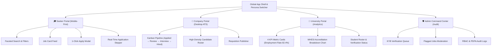

# Jobmatch UI/UX Design System Specification
**Project:** Jobmatch (4-Sided Talent & Employability Ecosystem)  
**Lead UI/UX Designer & Design System Lead:** Maya Lin  
**Target Audience:** Alex Vance (CEO), Sophia Chen (Lead PM), Engineering Core, and Client  
**Interactive Wireframe Prototype:** [`wireframe_preview.html`](file:///C:/Users/b/OneDrive/Desktop/Agent%20Office/workspaces/jobmatch/wireframe_preview.html)

---

## 1. Visual Theme & Design Tokens

Jobmatch is architected to balance high institutional trustworthiness (for universities and enterprise employers) with energetic modern minimalism (for students and graduates).

### 1.1 Color Palette & Semantic Tokens

| Token Role | Color Name | Hex Code | Purpose & Semantic Usage |
| :--- | :--- | :--- | :--- |
| **Primary Brand** | Royal Cobalt Blue | `#2563EB` | Primary CTA, links, active navigation tabs, interactive elements |
| **Primary Dark** | Deep Royal Navy | `#1E3A8A` / `#0F172A` | Hero container backgrounds, primary high-contrast typography |
| **Growth / Success** | Growth Emerald | `#10B981` / `#059669` | 1-Click apply buttons, positive placement metrics, verified badges |
| **University Accent** | Amethyst Violet | `#7C3AED` | University portal branding, student rosters, higher ed analytics |
| **Admin Accent** | Governance Amber | `#D97706` | Pending verification flags, moderation alerts, audit warnings |
| **Surface Base** | Slate White | `#F8FAFC` | App global canvas background, reduces screen glare |
| **Surface Card** | Pure White | `#FFFFFF` | Elevated card containers, modals, high-density table rows |
| **Borders & Dividers**| Soft Slate Gray | `#E2E8F0` / `#CBD5E1` | Subtle container borders, grid dividers, form field borders |
| **Text Primary** | Obsidian Slate | `#0F172A` | Headings, applicant names, company names |
| **Text Muted** | Slate Secondary | `#64748B` | Timestamps, metadata, helper text, breadcrumbs |

### 1.2 Typography Hierarchy
* **Font Family:** `Plus Jakarta Sans`, `Inter`, paired with `Prompt` for bilingual Thai/English legibility.
* **Scale:**
  * **H1 / Hero Title:** 28px – 32px | Bold (700/800) | Line-height: 1.2
  * **H2 / Section Title:** 20px – 24px | Bold (700) | Line-height: 1.3
  * **H3 / Card Title:** 16px – 18px | SemiBold (600) | Line-height: 1.4
  * **Body Regular:** 14px – 15px | Regular (400) | Line-height: 1.5
  * **Caption / Meta:** 11px – 12px | Medium (500) | Line-height: 1.4

### 1.3 Elevation & Spacing
* **8-Point Grid System:** Spacing tokens in multiples of 4px / 8px (`p-2` = 8px, `p-4` = 16px, `p-6` = 24px).
* **Corner Radius:** `rounded-xl` (12px) for cards, `rounded-2xl` (16px) for major dashboard panels, `rounded-full` for status pills.
* **Shadow Hierarchy:** Subtle diffuse shadows (`shadow-xs` / `shadow-sm` on rest, elevating to `shadow-md` on hover).

---

## 2. Wireframe Layout & Component Hierarchy

### 2.1 4-Persona Workspace Architecture

---

## 3. User Interaction Flows & State Transitions

### 3.1 1-Click Application Flow (Seeker)
1. User filters and clicks "สมัครงานทันที (1-Click Apply)" on any verified requisition.
2. Modal opens presenting **Verified Academic Credentials** from their university (eliminating redundant upload steps).
3. User adds optional personalized note and clicks "ยืนยันการส่งใบสมัคร".
4. Card updates to `Applied` state, and an interactive step progression bar appears on the seeker's tracking timeline.

### 3.2 Candidate Pipeline Flow (Company)
* **Kanban Mode:** Visual columns with card counts and quick "ขยับขั้น ➔" action buttons.
* **List View Mode:** High-density table with single-click CSV export and batch status updates.
* **Instant University Sync:** Once moved to `Hired`, the student's status automatically switches in the university roster to `Employed In-Field`.

### 3.3 Core UX States Specification

| State | Visual Behavior & Feedback |
| :--- | :--- |
| **Active / Interactive** | Crisp borders, responsive focus rings (`ring-2 ring-brand-500`), smooth hover elevations, immediate toast notifications. |
| **Loading** | Accessible pulse skeleton loaders (`animate-pulse`) for cards, text rows, and table cells to avoid jarring layout shifts (CLS). |
| **Empty State** | Friendly iconography, contextual explanatory text, and prominent primary CTA (e.g. "ยังไม่มีประวัติการสมัครงาน → ค้นหางานเดี๋ยวนี้"). |
| **Error / Flagged** | High-contrast crimson accents (`#DC2626`, `bg-red-50`), clear remedial action instructions (e.g. "ขนาดไฟล์เกิน 5MB กรุณาเลือกไฟล์ใหม่"). |

---

## 4. Visual Prototype Reference
Open [`wireframe_preview.html`](file:///C:/Users/b/OneDrive/Desktop/Agent%20Office/workspaces/jobmatch/wireframe_preview.html) in any standard browser to test the interactive views, role switcher, ATS Kanban toggle, and modal application flow.
