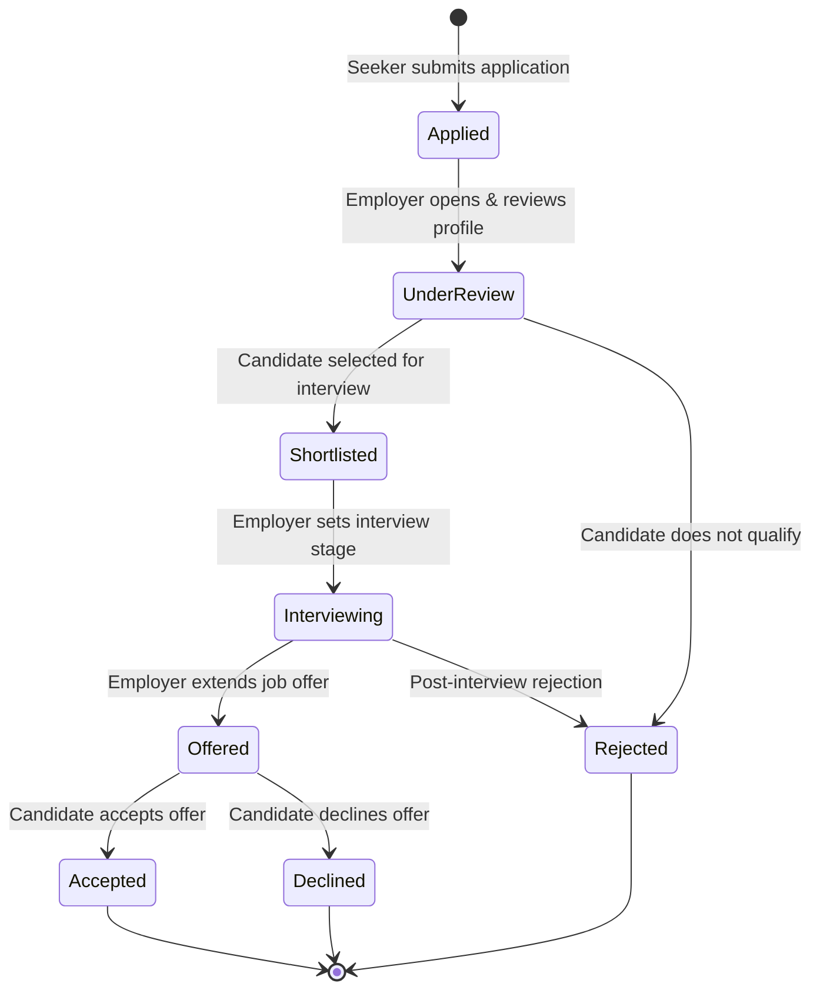
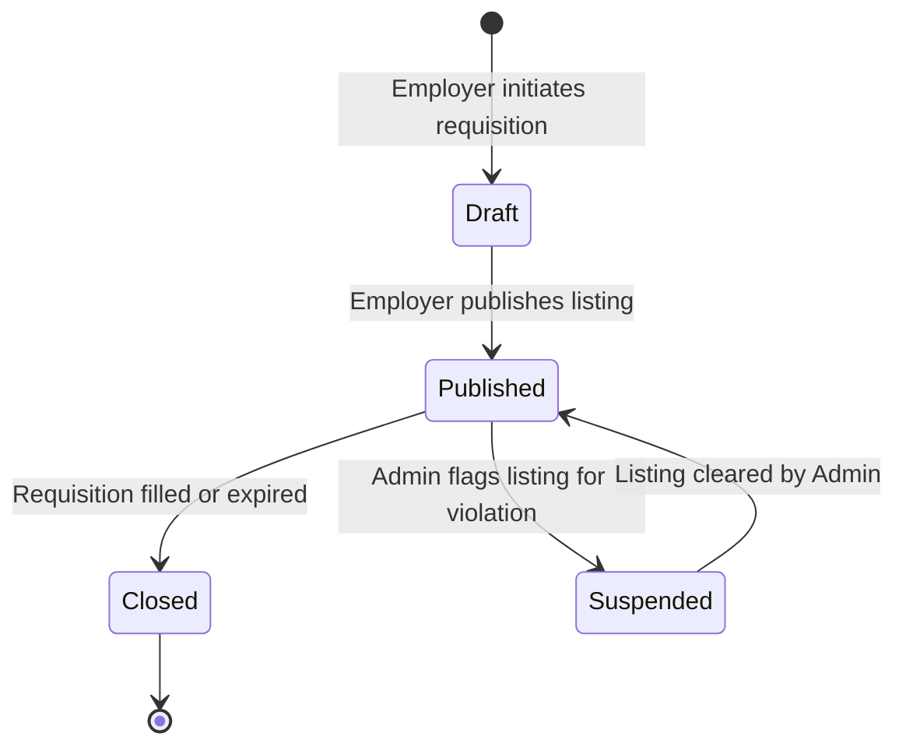

# Product Requirements Document (PRD): Jobmatch

**Project:** Jobmatch (4-Sided Talent & Employability Platform)  
**Author:** Sophia Chen, Lead Product Manager (PM)  
**Stakeholders:** Alex Vance (CEO), Maya Lin (Lead UI/UX Designer), Engineering Core  
**Date:** November 2, 2026  
**Status:** Approved for Design & Architecture Sprint  

---

## 1. Executive Product Overview & Personas

### 1.1 Product Summary
Jobmatch is an integrated, 4-sided employability and recruitment ecosystem connecting **Job Seekers/Students**, **Companies/Employers**, **Universities/Career Centers**, and **Platform Administrators**. Unlike generic job boards, Jobmatch bridges the academia-to-industry transition by combining verified institutional talent pipelines, a lightweight ATS for employers, automated graduate outcome reporting for universities, and strict role-based governance.

### 1.2 Target Personas

| Persona | Role & Context | Core Goals | Frustrations & Pain Points |
| :--- | :--- | :--- | :--- |
| **Somchai (Job Seeker / Student)** | 22-year-old graduating Senior in Computer Science / Business looking for first full-time role or internship. | - Discover legitimate, verified job opportunities.<br>- Apply effortlessly using an online resume profile.<br>- Track application progression without opacity. | - Applying into a "black hole" with zero updates.<br>- Fragmented job boards and scam listings.<br>- Inability to showcase university-verified background. |
| **Khun Ploy (Employer / Talent Acquisition)** | HR Lead at an agile tech SME / enterprise hiring 20+ graduates annually. | - Post open requisitions quickly.<br>- Filter and evaluate pre-screened fresh graduates.<br>- Move candidates through an ATS pipeline smoothly. | - Drowning in unqualified resumes.<br>- Disconnected offline university job fairs.<br>- Expensive, clunky enterprise ATS platforms. |
| **Dr. Kanya (University Career Center Director)** | Head of Career Services responsible for annual Ministry of Higher Education accreditation KPIs. | - Track graduate employment status in real time.<br>- Generate cohort employability reports.<br>- Connect students directly with verified partner companies. | - Chasing alumni via slow surveys with <30% response rates.<br>- Inability to prove educational ROI to incoming students.<br>- Disjointed spreadsheets. |
| **Admin Art (Platform Administrator & Compliance)** | Security and Operations Officer responsible for platform integrity. | - Prevent fraudulent job postings & spam accounts.<br>- Enforce RBAC security and Thai PDPA compliance.<br>- Audit system health and activity logs. | - Manual review bottlenecks.<br>- Security risks regarding student personal records.<br>- Difficult cross-role dispute resolution. |

---

## 2. Core Feature Specifications & MVP Boundaries

### 2.1 Scope Prioritization (MoSCoW Matrix)

```
+-----------------------------------------------------------------------------------+
| MUST HAVE (MVP Release)                                                           |
| - Unified Auth & 4-Tier RBAC (Seeker, Company, University, Admin)                 |
| - Seeker Profile & Standardized Online Resume Builder                             |
| - Job Catalog with Multi-Criteria Filter & Search Engine                          |
| - 1-Click Application Flow with Real-Time Status Tracker                          |
| - Employer Job Posting Lifecycle (Draft, Publish, Close)                          |
| - Employer Kanban/List Lightweight ATS Pipeline                                   |
| - University Student Roster & Employment Outcome Dashboard                        |
| - Admin User/Org Moderation & Job Approval System                                 |
+-----------------------------------------------------------------------------------+
| SHOULD HAVE (Post-MVP Fast Follow)                                                |
| - University-Company Partnership Tagging / Campus Placement Drives                |
| - Exportable Excel/CSV Cohort Compliance Reports for Universities                 |
| - In-app Notifications for Application Status Changes                             |
+-----------------------------------------------------------------------------------+
| COULD HAVE (Phase 2 Roadmap)                                                      |
| - AI-powered Resume Parsing & Semantic Skill Matching Score                       |
| - In-platform Messaging / Interview Scheduling Calendar Integration               |
+-----------------------------------------------------------------------------------+
| WON'T HAVE (Strictly Out-of-Scope for Phase 1)                                    |
| - In-platform live video interviewing                                             |
| - Paid subscription & payment gateway processing (PromptPay/Stripe)               |
| - Bi-directional direct API integration with university legacy SIS/ERP            |
+-----------------------------------------------------------------------------------+
```

---

## 3. Workflow State Machines

### 3.1 Job Application State Machine


### 3.2 Job Posting Lifecycle State Machine


### 3.3 Graduate Employment Status (University Tracking)
- **Seeking Employment (กำลังหางาน):** Active seeker, unplaced.
- **Employed - In-Field (ได้งานทำตรงสาย):** Employed in field related to major.
- **Employed - Out-of-Field (ได้งานทำไม่ตรงสาย):** Employed outside major focus.
- **Continuing Education (ศึกษาต่อ):** Graduate school / specialized training.
- **Entrepreneur / Freelance (ประกอบอาชีพอิสระ/ธุรกิจส่วนตัว).**

---

## 4. Detailed User Stories & Acceptance Criteria

### Module 1: Unified Authentication & RBAC

#### US-1.1: Multi-Role Registration & Login
**As a** prospective user (Job Seeker, Company Representative, or University Coordinator),  
**I want to** select my role during registration and authenticate securely,  
**So that** I gain access to my dedicated, permission-controlled workspace.

**Acceptance Criteria:**
1. **Given** an unauthenticated visitor on `/register`,  
   **When** viewing the registration page,  
   **Then** they see 3 distinct self-service role choices: *Job Seeker (ผู้หางาน)*, *Company (บริษัท)*, and *University (มหาวิทยาลัย)*. (Admin accounts are seeded or provisioned only by system super-admins).
2. **Given** valid registration fields (Email, Strong Password, Full Name/Entity Name),  
   **When** form is submitted,  
   **Then** a secure hashed user entity is created with the exact assigned role, and a JWT session/cookie is established.
3. **Given** an authenticated user with role `SEEKER`,  
   **When** they attempt to directly navigate to `/company/dashboard` or `/admin`,  
   **Then** the RBAC middleware immediately blocks access with an `HTTP 403 Forbidden` and redirects to `/jobs`.

---

### Module 2: Job Seeker Experience

#### US-2.1: Profile & Resume Builder
**As a** Job Seeker,  
**I want to** build an online profile showcasing my education, university affiliation, skills, and work experience,  
**So that** employers and my university can view my verified credentials.

**Acceptance Criteria:**
1. **Given** an authenticated Job Seeker on `/profile`,  
   **When** updating their university, major, GPA, graduation year, technical skills, and portfolio links,  
   **Then** changes persist in the database and display a "Profile Strength Indicator" (e.g., 85% Complete).
2. **Given** a seeker with an existing PDF resume,  
   **When** uploading a file (max 5MB, PDF only),  
   **Then** the system validates file type/size, stores it safely, and links it as the primary attachable resume.

#### US-2.2: Job Search & Filtering
**As a** Job Seeker,  
**I want to** search and filter jobs by keyword, role type, location, and salary,  
**So that** I quickly discover relevant opportunities matching my background.

**Acceptance Criteria:**
1. **Given** the `/jobs` search portal,  
   **When** a user types a query (e.g., "Frontend Developer") and filters by Employment Type (`Full-time`, `Internship`) and Location (`Bangkok`, `Remote`),  
   **Then** results update instantly with matching active postings.
2. **Given** zero search results,  
   **When** no jobs match the selected criteria,  
   **Then** a friendly empty state is rendered with a "Reset Filters" action.

#### US-2.3: 1-Click Application & Real-Time Tracking
**As a** Job Seeker,  
**I want to** apply to a job listing with my profile and track its progress,  
**So that** I stay informed on whether I am under review, shortlisted, or rejected.

**Acceptance Criteria:**
1. **Given** an active job detail view,  
   **When** the user clicks "Apply Now",  
   **Then** a confirmation modal confirms the resume and optional cover note before submission.
2. **Given** an already applied job,  
   **When** viewing the job detail or search list,  
   **Then** the "Apply Now" button changes to a disabled badge: "Applied (รอพิจารณา)".
3. **Given** the `/applications` dashboard,  
   **When** an applicant views their submissions,  
   **Then** each card clearly displays the company name, position, applied date, and status pill tag (`Submitted`, `Under Review`, `Shortlisted`, `Offered`, `Rejected`).

---

### Module 3: Company / Employer Experience

#### US-3.1: Company Profile & Job Posting Management
**As a** Company Representative,  
**I want to** create and manage job postings with comprehensive requirements,  
**So that** candidates have complete information before applying.

**Acceptance Criteria:**
1. **Given** a Company user on `/company/jobs/new`,  
   **When** filling in Title, Department, Job Type, Location/Remote, Salary Range, Qualifications, and Application Deadline,  
   **Then** they can either save as `Draft` or click `Publish`.
2. **Given** an active listing,  
   **When** the position is filled,  
   **Then** the employer can toggle status to `Closed`, preventing new applications while keeping existing records.

#### US-3.2: Applicant Pipeline & Lightweight ATS
**As a** Company Hiring Manager,  
**I want to** review applicants in an organized pipeline and update their stages,  
**So that** I can process candidates systematically from submission to hire.

**Acceptance Criteria:**
1. **Given** a job with incoming candidates on `/company/jobs/:id/applicants`,  
   **When** the employer reviews candidates,  
   **Then** they can view candidate profiles, download their PDF resumes, and see their university cohort data.
2. **Given** a candidate card,  
   **When** the employer changes the stage dropdown from `Submitted` to `Shortlisted` or `Rejected`,  
   **Then** the database updates immediately, and the applicant's view reflects the new status in real time.

---

### Module 4: University Portal & Employability Analytics

#### US-4.1: Student Directory & Affiliation Management
**As a** University Career Center Coordinator,  
**I want to** view students affiliated with our institution and their current employment status,  
**So that** we maintain accurate records for institutional accreditation.

**Acceptance Criteria:**
1. **Given** an authenticated University user on `/university/students`,  
   **When** loading the roster,  
   **Then** the table displays Student Name, Major/Faculty, Graduation Year, Current Status (`Seeking`, `Employed`, `Continuing Studies`), and Placed Company (if available).
2. **Given** a student who self-reported or secured a job through Jobmatch,  
   **When** the status is updated,  
   **Then** the university roster automatically reflects the new placement without manual data entry.

#### US-4.2: Graduate Employability Analytics Dashboard
**As a** University Career Center Director,  
**I want to** view high-level metrics and visual charts on cohort employment rates,  
**So that** I can evaluate faculty performance and prepare compliance reports.

**Acceptance Criteria:**
1. **Given** the `/university/dashboard`,  
   **When** viewing the analytics panel,  
   **Then** the UI renders 4 key summary KPIs:  
   - Total Tracked Students  
   - Overall Employment Rate (%)  
   - In-Field vs. Out-of-Field Placement Ratio  
   - Top Hiring Partner Industries / Companies.
2. **Given** cohort filter controls (e.g., Class of 2026, Faculty of Engineering),  
   **When** filtered,  
   **Then** charts and breakdown tables recalculate dynamically.

---

### Module 5: Admin Command Center

#### US-5.1: User & Organization Verification & Moderation
**As a** Platform Administrator,  
**I want to** manage users, approve company accounts, and moderate suspicious listings,  
**So that** the platform remains trusted, verified, and scam-free.

**Acceptance Criteria:**
1. **Given** the `/admin/users` management table,  
   **When** searching for any user or organization,  
   **Then** the admin can view their status (`Active`, `Pending Verification`, `Suspended`) and toggle their active state.
2. **Given** a reported or suspicious job posting on `/admin/jobs`,  
   **When** the admin flags it as `Suspended`,  
   **Then** it is immediately removed from public seeker discovery and the employer is notified.

---

## 5. UI/UX Handoff Directives for Maya Lin (Lead Designer)

### 5.1 Design Principles & Visual Hierarchy
- **Tone & Mood:** Trustworthy, crisp, professional, and contemporary (Modern Tech meets Academic Credibility).
- **Primary Color Palette Recommendation:**
  - *Brand Primary:* Deep Trust Blue (`#1E40AF` or `#2563EB`) – conveys security and institutional reliability.
  - *Accent / Action:* Vibrant Teal / Emerald (`#059669` or `#0D9488`) – represents growth, career success, and active CTAs.
  - *Role Color Coding:* Subtle badges to differentiate workspaces:
    - Seeker: Emerald / Indigo
    - Employer: Sapphire Blue
    - University: Violet / Purple
    - Admin: Slate / Amber
- **Typography:** Clean sans-serif with excellent Thai & Latin glyph harmony (e.g., Inter + Kanit/Prompt or Sukhumvit fallback).

### 5.2 Device & Layout Strategies
- **Job Seeker Portal:** **Mobile-First & App-like.** Bottom navigation or responsive sticky header; high-touch cards for job browsing; tap-friendly 1-click apply.
- **B2B Portals (Company, University, Admin):** **Desktop-Optimized, High-Density.** Collapsible sidebar navigation, dense data tables with pagination/filters, clean modal drawers for candidate details, and responsive grid metric cards.

### 5.3 Essential Screens Required for Sprint 1
1. `Auth / Role Select`: Multi-role login and registration onboarding split.
2. `Seeker - Job Feed & Filters`: Search bar, filter drawer/sidebar, job list cards with status chips.
3. `Seeker - Application Tracker`: Tabbed view (`All`, `Under Review`, `Shortlisted`, `Offered`, `Archived`).
4. `Company - ATS Pipeline`: Candidate roster/Kanban with stage transitions and resume preview.
5. `University - Employability Dashboard`: Metric KPI summary cards + Faculty employment distribution chart + Student roster table.
6. `Admin - Management Portal`: Tabular user and posting moderation view with quick action toggles.
